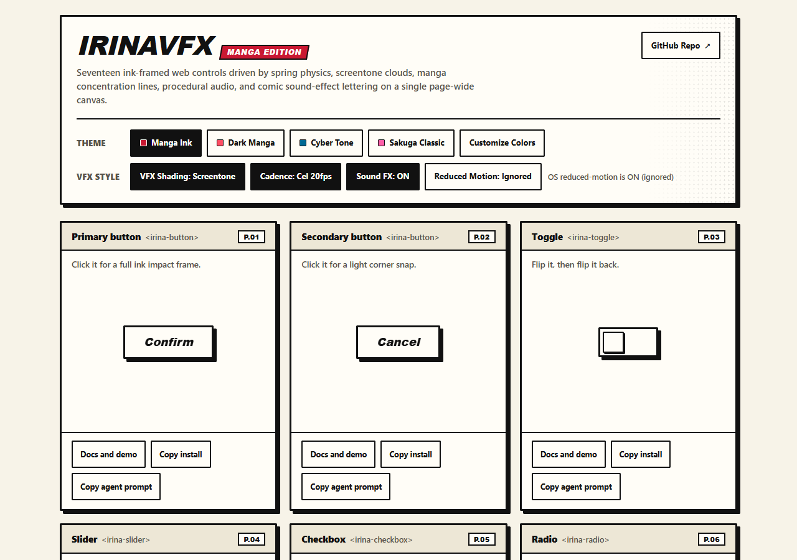
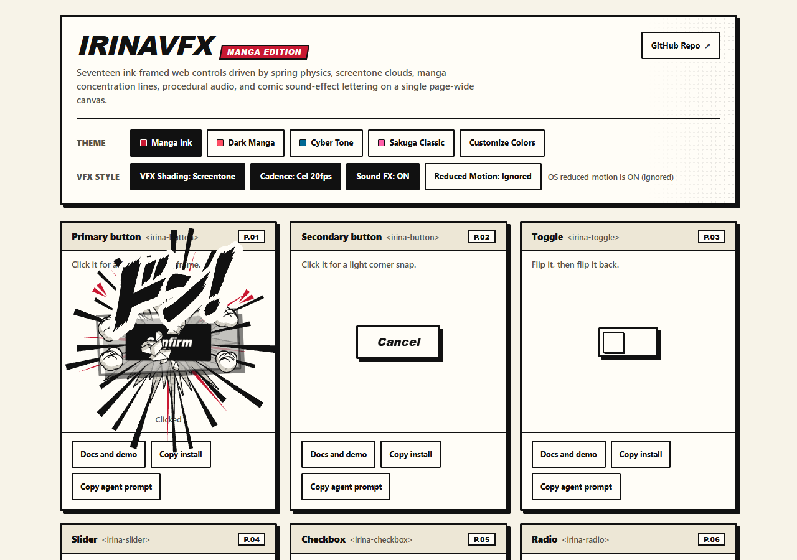
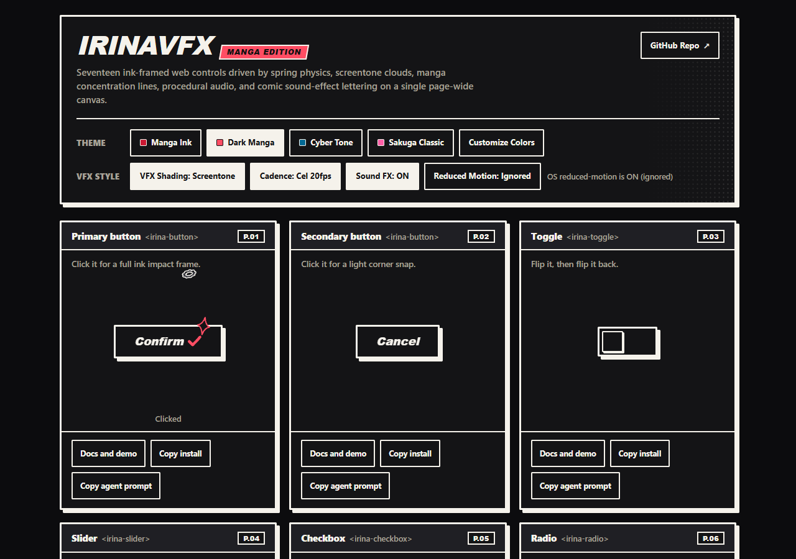
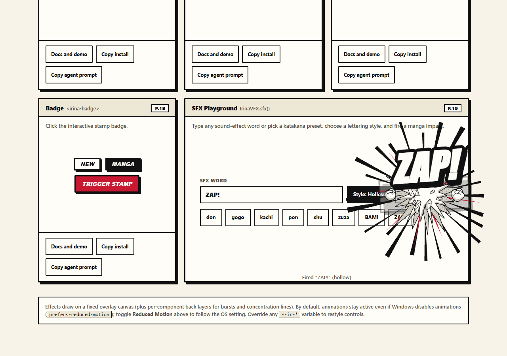

# IrinaVFX (Manga Edition)

Ink-framed UI controls that react like a shonen manga page. At rest they sit inside sharp manuscript panels with hard ink shadows. Interact with one and it squashes and overshoots on springs while throwing screentone smoke puffs, impact bursts, concentration lines (`shuchu`), crystal shards, slashes, splashes, procedural audio, and manga sound-effect lettering (`ドン!`, `カチッ`, `ズザッ`, or any custom text).

Every effect is drawn in code on a fixed canvas over the page (plus per-component back layers for impact bursts and concentration lines behind panels). No external runtime dependencies, no build step required to use a component, MIT licensed.

## Screenshots

| Manga Ink Gallery | Impact Frame (`ドン!`) |
|---|---|
|  |  |

| Dark Manga Preset | Badge & SFX Playground |
|---|---|
|  |  |

## The seventeen

| | element | what happens |
|---|---|---|
| [Button](button/) | `<irina-button>` | Press and it squashes flat. Let go and it inverts for one frame, a flash and `shuchu` burst go off behind it, screentone clouds roll off the corners, and `ドン!` lands. `done()` puts a check on it. The secondary variant is a small squash and three wedges. |
| [Toggle](toggle/) | `<irina-toggle>` | Procedural manga switch: the knob stretches like a smear frame, the track floods with accent colour, and it slams into the end with `shuchu`, a `slash`, `splash`, and `カチッ`. |
| [Slider](slider/) | `<irina-slider>` | The thumb stretches into a teardrop on a spring. Sliding plays pitch-reactive ticks and kicks up screentone cumulus, speed lines, and `シュッ` (single clicks stay quiet); fast releases throw a crescent ahead. |
| [Checkbox](checkbox/) | `<irina-checkbox>` | Two crescents swing round the box, crystals fly, the tick draws itself, and `ズザッ` lands in dotted letters. |
| [Radio](radio/) | `<irina-radio>` | The dot springs in with a fan of wedges, two puffs, and a hollow `ポン`. |
| [Input](input/) | `<irina-input>` | Every key kicks up dust where the caret is. |
| [Tabs](tabs/) | `<irina-tabs>` | The raised tab slides, stretching, and lands with wedges and a puff. |
| [Progress](progress/) | `<irina-progress>` | A storm cloud rides the leading edge, pebbles lift off the ground, `ゴゴゴゴ`; at 100% a `shuchu` burst, `ドン!`, and a check land. |
| [Rating](rating/) | `<irina-rating>` | Stars pop in one after another; five gets a burst behind the row. |
| [Toast](toast/) | `<irina-toast>` | Streaks in as a smear, lands in dust with `ズザッ`, leaves by shrinking. |
| [Tooltip](tooltip/) | `<irina-tooltip>` | The hint springs out like a speech bubble with puffs and `カチッ`. |
| [Select](select/) | `<irina-select>` | Trigger squashes, menu springs open with puffs, and picking lands a glint and `カチッ`. |
| [Dialog](dialog/) | `<irina-dialog>` | Slams into view on a spring with `shuchu` concentration lines, an impact burst behind the panel, speed lines, puffs, and `ドン!`. |
| [Accordion](accordion/) | `<irina-accordion>` | Header squashes, body springs open, and bottom corners land with puffs and `ポン`. |
| [Counter](counter/) | `<irina-counter>` | Like/upvote button that pops with `shuchu`, a burst, shards, glint, and `ポン`. |
| [Drawer](drawer/) | `<irina-drawer>` | Slide-over sheet that streaks in as a smear and lands in dust with `ズザッ`. |
| [Badge](badge/) | `<irina-badge>` | Manga stamp badge (`default`, `accent`, `ink`) with optional `interactive` button mode, `el.stamp()`, and custom `sfx` word. |

## The Manga Edition Engine

- **Manga palette & panel geometry:** Warm manuscript paper (`#fffdf7`), sumi ink (`#111111`), vermilion accent (`#c91832`), sharp corners (`--ir-r: 2px`), and hard ink offset shadows (`--ir-sh: 5px 5px 0 var(--ir-ink)`). Every colour and radius is a `--ir-*` CSS variable, and the gallery includes **Manga Ink**, **Dark Manga**, **Cyber Tone**, **Sakuga Classic**, and a live color/shape customizer.
- **Screentone shading (`IrinaVFX.mangaTone`):** Shadow regions in clouds, bursts, splashes, and shards render with a 45-degree Ben-Day halftone dot pattern.
- **Cel-stepped cadence (`IrinaVFX.stepped`):** Canvas VFX steps at 20fps like hand-drawn cel animation (while rendering the initial hit frame immediately and keeping DOM springs smooth).
- **Manga primitives & custom SFX:** Adds `shuchu()` (concentration lines), `flash()` (impact panel flash), and custom text support in `sfx('BAM!', x, y)` alongside the six traced katakana words.
- **Procedural Web Audio (`IrinaVFX.sound`):** Synthesizes lightweight `impact`, `pop`, `snap`, `slide`, `whoosh`, and `sparkle` sounds with zero external audio files, gated on a user gesture with a mute toggle in the gallery.
- **Motion preference:** Animations stay active by default even when OS `prefers-reduced-motion` is enabled; set `IrinaVFX.respectReducedMotion = true` (or use the gallery toggle) to pause effects for reduced motion.

## Try them

Repo: https://github.com/dayy4dev/irina-fx

Run locally:

```sh
python3 -m http.server 8000     # from this folder
# open http://localhost:8000/gallery/
```

The gallery includes all seventeen controls live, theme presets, live color/shape customizer, VFX toggles, and an interactive **SFX Playground** panel.

## Use one

Each component is a single standalone file. Install it with the shadcn CLI, which places the file in `public/irina-fx/`:

```sh
npx shadcn add dayy4dev/irina-fx/button
npx shadcn add dayy4dev/irina-fx/toggle
npx shadcn add dayy4dev/irina-fx/slider
# ...checkbox, radio, input, tabs, progress, rating, toast, tooltip, select, dialog, accordion, counter, drawer, badge
```

Or copy the file into your project by hand, load it with a plain script tag, and use its element:

```html
<script src="button.js"></script>
<irina-button>Confirm</irina-button>

<script src="toggle.js"></script>
<irina-toggle label="Notifications"></irina-toggle>

<script src="badge.js"></script>
<irina-badge interactive variant="accent" sfx="BAM!">Trigger Stamp</irina-badge>
```

Each folder's README lists its attributes, properties, and events. Form-associated controls (`toggle`, `slider`, `checkbox`, `radio`, `input`, `rating`, `select`, `counter`) submit with a `<form>` via `name`.

**How the files share.** Every component file carries its own copy of `core.js` (springs, effects canvas, lettering, and procedural audio). The first component loaded sets `window.IrinaVFX` and the rest reuse it, so any mix on a page shares one canvas and one animation loop.

For agents, [llms.txt](llms.txt) lists every file and what it is. Each card in the gallery also has install and agent-prompt copy buttons.

## Make your own

`skills/irina-fx/` contains the workflow these controls were built with:

```sh
npx skills add dayy4dev/irina-fx
```

- `SKILL.md` is the workflow and guidelines.
- `core.js` is the shared core.
- `starter.html` is a minimal single-file example.
- `look.mjs` steps an animation frame by frame to inspect timing.

## Working on this repo

- `core.js` is the source of the shared core. After editing it, run `node tools/build.mjs` to copy it into all 17 component files (between the `// >>> irina core` markers) and into `skills/irina-fx/core.js`. `node tools/build.mjs --check` exits 1 if any file is out of date.
- `art/words/` holds the six painted sound-effect words; `tools/trace.py` traces them into `WORDS` paths in `core.js`.
- `node tools/test.mjs http://localhost:8000/gallery/` drives all 17 controls with touch and key events at 390px phone width, checks form submission and horizontal overflow, and exits 1 on failure. `node tools/shot.mjs URL OUT W H SCALE` captures a screenshot. Both require Chrome/Chromium or Edge (`CHROME=...`).

## Limits

- **Checked in headless Chromium/Edge,** with touch and keyboard events. Not yet tested across Safari, Firefox, or physical mobile devices.
- **The front effects canvas sits at the highest z-index** (`pointer-events: none`), so effects can fly over modals or headers.
- **Back-layer bursts** (`button`, `progress`, `rating`, `counter`, `badge`) draw inside the component's host and are clipped if a parent has `overflow: hidden`.
- **When `respectReducedMotion = true` and OS reduced motion is on,** canvas effects and audio are paused while spring state changes settle immediately.

## Credits

Originally created by **Justin Finkelman** ([finktheartist](https://github.com/finktheartist)) as [Sakuga VFX](https://github.com/finktheartist/sakuga-vfx). IrinaVFX is a customized fork and rebrand built on top of the original project.

## License

MIT. See [LICENSE](LICENSE) (Copyright (c) 2026 Justin Finkelman).
